# SuperFX Studio (`sfx-studio`) — Human Authoring Use-Case Guide

This guide walks through the **9 core human authoring workflows** for building SuperFX (GSU / FX3) **Atlas Documents** (`.sfxproj` / `.sfxatlas`) and isometric tactical **Level Documents** (`.sfxlevel`) in **SuperFX Studio**, grounded in real production scenes from `snes-sfx-demo` (`ProtagonistRoom`, `IsoRPGDemo`, and `IsoEngine`).

Every workflow is verified deterministically across three target viewport classes ([ADR-0001](../adr/0001-adaptive-desktop-tablet-ui-and-headless-scene-harness.md) · [UX_DESIGN_SPEC.md](UX_DESIGN_SPEC.md)):

| Viewport Class | Target Form Factor | Capture Resolution | Adaptive Layout Behavior |
|---|---|---|---|
| **Expanded Desktop** | Workstation / external monitor | `1600 × 960` | Full labeled Two-Tier Header, pinned collapsible Left & Right Docks, side-by-side `Split` viewports |
| **Medium (Tablet Landscape)** | 2-in-1 convertible / Surface / compact laptop | `1024 × 768` | Icon-condensed secondary actions, `52dp` `LevelToolRail` + Mask popover, `FlowRow` wrapping toolbars |
| **Compact (Tablet Portrait)** | Portrait stylus tablet / split-screen window | `768 × 1024` | Auto `Touch Comfort` (`40–42dp` hit targets), docked Bottom Sheets, vertical `Split` `Column` (`>700dp` wide viewports) |

> [!TIP]
> Regenerate all 34 screenshots headlessly at any time from `sfx-studio/`:
> ```bash
> SFX_GUIDE_PHASE=after ./mvnw test -pl sfx-studio-desktop -am \
>   -Dkotlin.compiler.execution.strategy=in-process \
>   -Dsurefire.failIfNoSpecifiedTests=false \
>   -Dtest=UserGuideScreenshotGeneratorTest
> ```
> Pre-overhaul baseline captures remain archived under [`screenshots/before/`](screenshots/before/) for visual comparison.

---

## Use Case 1: Multi-Document Studio Shell, Touch Ergonomics & Onboarding

**Goal**: Launch SuperFX Studio, switch between open **Atlas Documents** and **Level Documents**, toggle **Touch Comfort** or **UI Scale** directly from the header without needing an OS `MenuBar` or physical keyboard, and start a project from the Quick-Start Deck.

### Human Steps
1. Launch `./scripts/sfx-studio.sh` (optionally passing existing `.sfxproj` and `.sfxlevel` files).
2. Use **Tier 1** of the Studio Header to switch tabs (color-coded `DocAtlas` vs `DocLevel` icons and amber unsaved-change dots), click **`+ New`** to create an Atlas, create a Level, or open an existing document, and adjust **Touch Comfort** (`Auto` / `Touch` / `Compact`) or **UI Scale** (`100%–200%`).
3. On a fresh untitled **Atlas Document**, pick **Import Source Textures**, **New Isometric Level**, or **Open Existing Project** directly from the centered Onboarding Card Deck.

### Multi-Viewport Captures
- **Desktop (`1600×960`)**:
  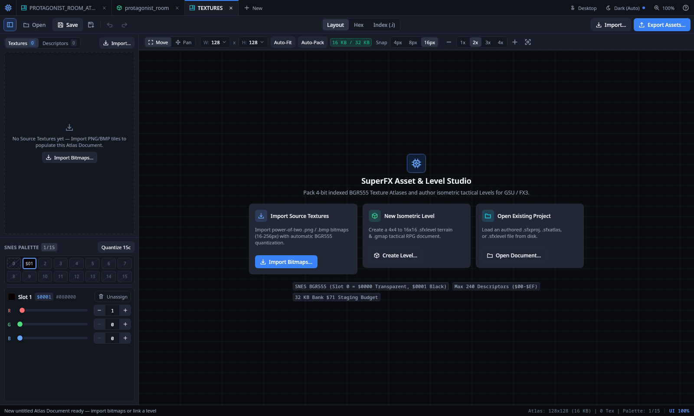
- **Tablet Landscape (`1024×768`)**:
  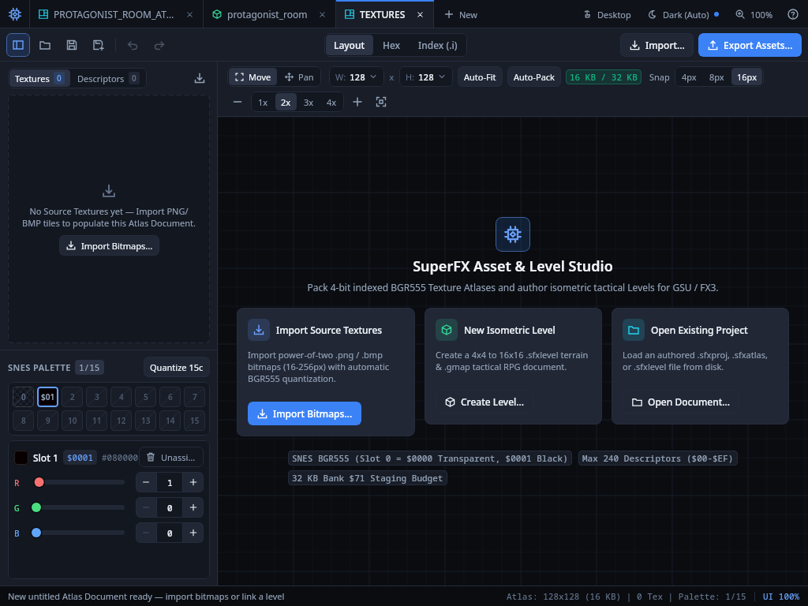
- **Tablet Portrait (`768×1024` — Auto Touch Comfort + Docked Catalog Sheet)**:
  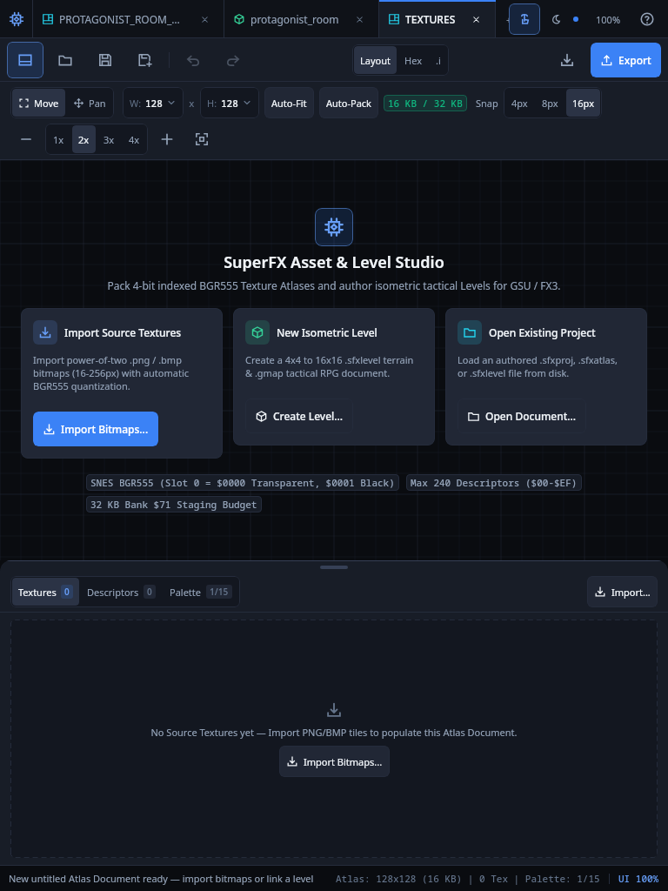

---

## Use Case 2: Importing Bitmaps & Resolving Palette Conflicts

**Goal**: Import an artist-authored PNG tile or prop (`stained_glass_window.png`) into an **Atlas Document** when incoming colors exceed open slots in the 16-color SNES BGR555 palette (`Slot 0` = `$0000` transparent, `Slots 1..15` = opaque).

### Human Steps
1. Open `PROTAGONIST_ROOM_ATLAS.sfxproj` and click **Import...** in the Command Bar or Catalog Dock.
2. In **Resolve Palette Conflict** (`PendingTextureImport`), compare the **`NEW`** incoming preview tile side-by-side against existing **Source Textures**.
3. Choose **Auto-Snap & Import** (keeps existing palette colors untouched), **Re-Quantize All & Import** (global 15-color Median-Cut across all textures), or manually map individual overflow colors via the visual `4×4` palette swatch grid popover and click **Apply Mapping**.

### Multi-Viewport Captures
- **Desktop (`1600×960`)**:
  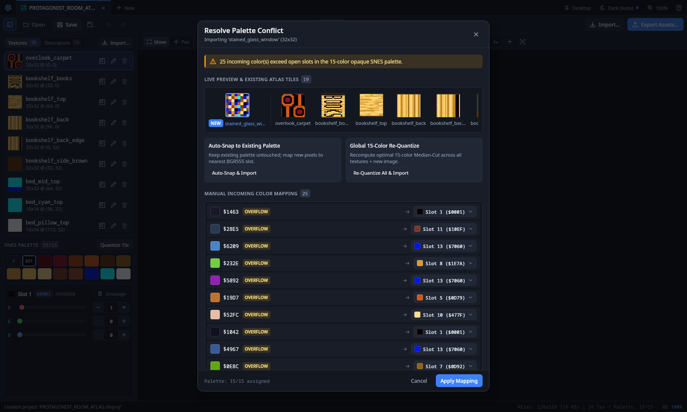
- **Tablet Landscape (`1024×768`)**:
  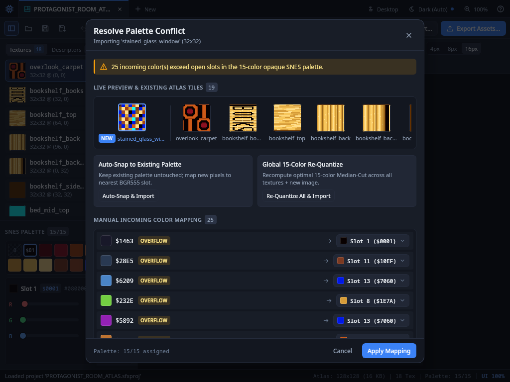
- **Tablet Portrait (`768×1024` — Viewport-Bounded Scrollable Dialog)**:
  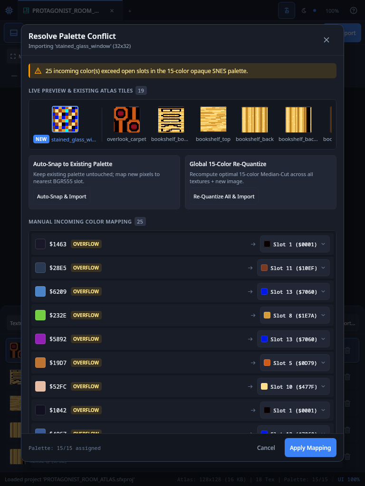

---

## Use Case 3: Source Texture Pixel Editing & BGR555 Palette Tuning

**Goal**: Tune 5-bit-per-channel (`0..31`) SNES BGR555 palette slots (`$0001` opaque black badge, checkerboard `Slot 0`) with sliders or exact `−/+` steppers, and touch up individual texels on a **Source Texture**.

### Human Steps
1. Select any palette swatch (`1..15`) in the **SNES Palette** section and adjust `R`, `G`, `B` (`0..31`) via track sliders or `−/+` numeric steppers (`Unassign` stays muted until hovered).
2. Click the **Edit** pencil icon on a **Source Texture** (`stone_floor` in `DEMO_ATLAS.sfxproj`) to open **Edit Source Texture**.
3. Paint texels with **Pencil** (`[B]`), **Fill** (`[G]`), or **Eyedrop** (`[I]`), switch to **Pan** (`[H]`) and zoom (`− / Fit / +`) for safe touch/stylus navigation, inspect the `1×` live preview badge, and click **Apply Changes**.

### Multi-Viewport Captures
- **Desktop (`1600×960`)**:
  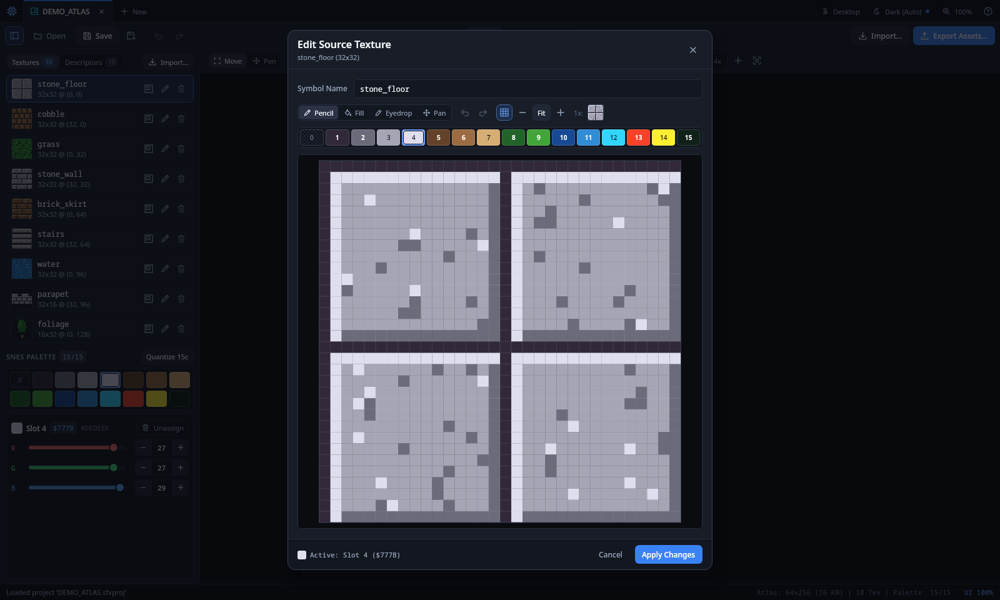
- **Tablet Portrait (`768×1024`)**:
  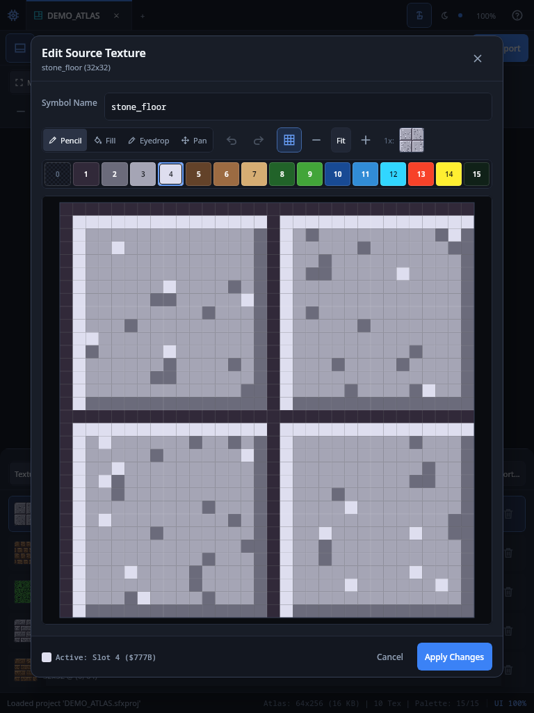

---

## Use Case 4: Atlas Packing, Virtual Slices, Descriptor Aliases & Binary Inspection

**Goal**: Pack **Source Textures** onto a power-of-two sheet, author zero-VRAM **Virtual Slices** and **Descriptor Aliases**, pin/reorder `$00..$EF` **Descriptor Table** slots, monitor the `32 KB` Bank `$71` budget, inspect `.bin`/`.pal` hex & `.i` **Atlas Index** output, and export companion assets.

### Human Steps
1. Open `TEXTURES.sfxproj` on **Layout**; adjust `W × H` (`16..256`), `Snap` (`4/8/16px`), `[Move | Pan]`, or **Auto-Pack** / **Auto-Fit** while checking the live `Bank $71` byte budget badge.
2. Click the **Slice** icon on any **Source Texture** (or switch the catalog to **Descriptors** and click **`+ Slice`** / **`+ Alias`**) to define power-of-two sub-rectangles (`roof_top_half`) with a live interactive sub-rect canvas and dashed cyan overlay on `AtlasCanvas`, plus symbolic aliases (`hero_trim_alias`) and **`Pinned`** descriptor slot ordering.
3. Inspect **Hex** (clickable BGR555 words + `"Jump"` to highlighted texture/slice byte span) and **Index (`.i`)** (line-numbered, syntax-tinted ca65 header), then click **Export Assets...** to write `.bin`, `.pal`, `.tab`, `.i`, and `_atlas.png`.

### Multi-Viewport Captures
- **Layout & Inline Slice/Alias Tree — Desktop (`1600×960`)**:
  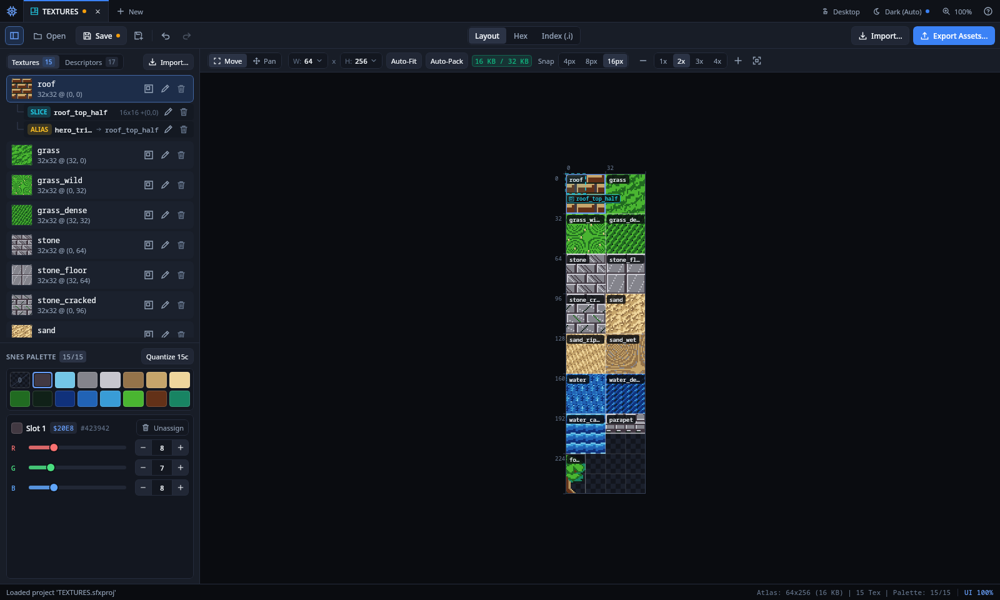
- **Layout & Slices — Tablet Landscape (`1024×768`)**:
  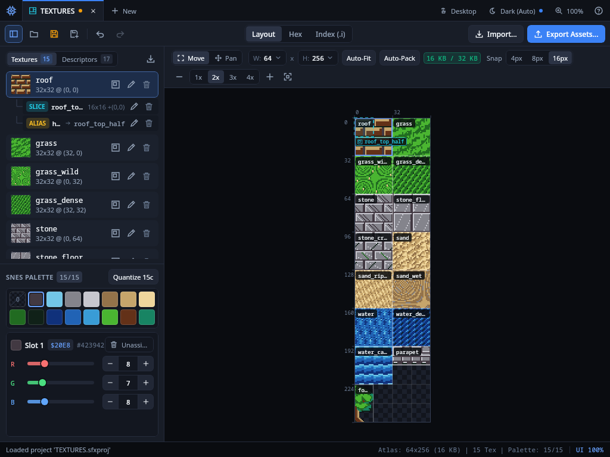
- **Layout & Slices — Tablet Portrait (`768×1024` — Full-Width Canvas + 3-Tab Bottom Sheet)**:
  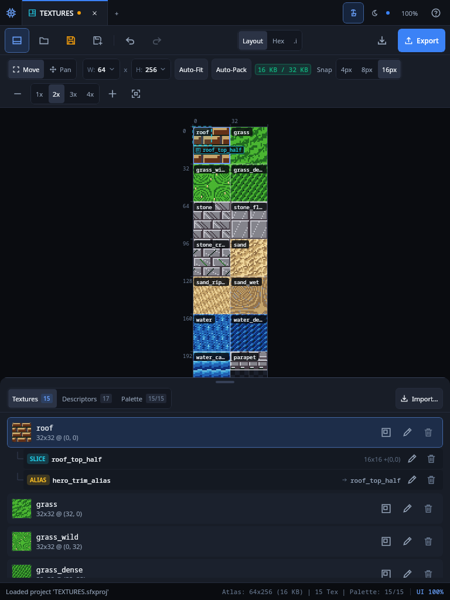
- **Interactive Virtual Slice Editor & `$00..$EF` Descriptor Table — Desktop & Tablet Portrait**:
  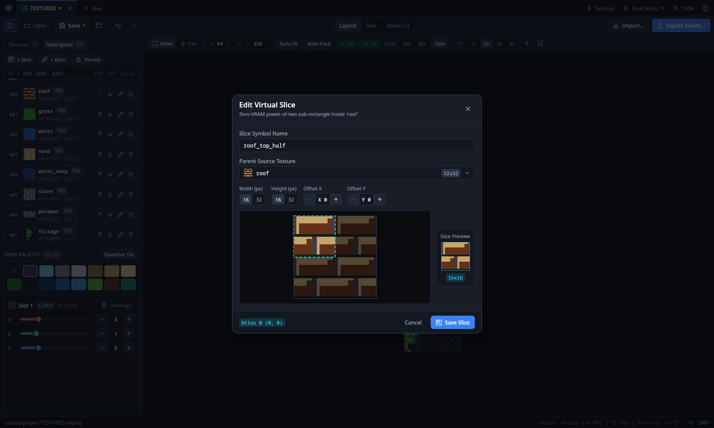
  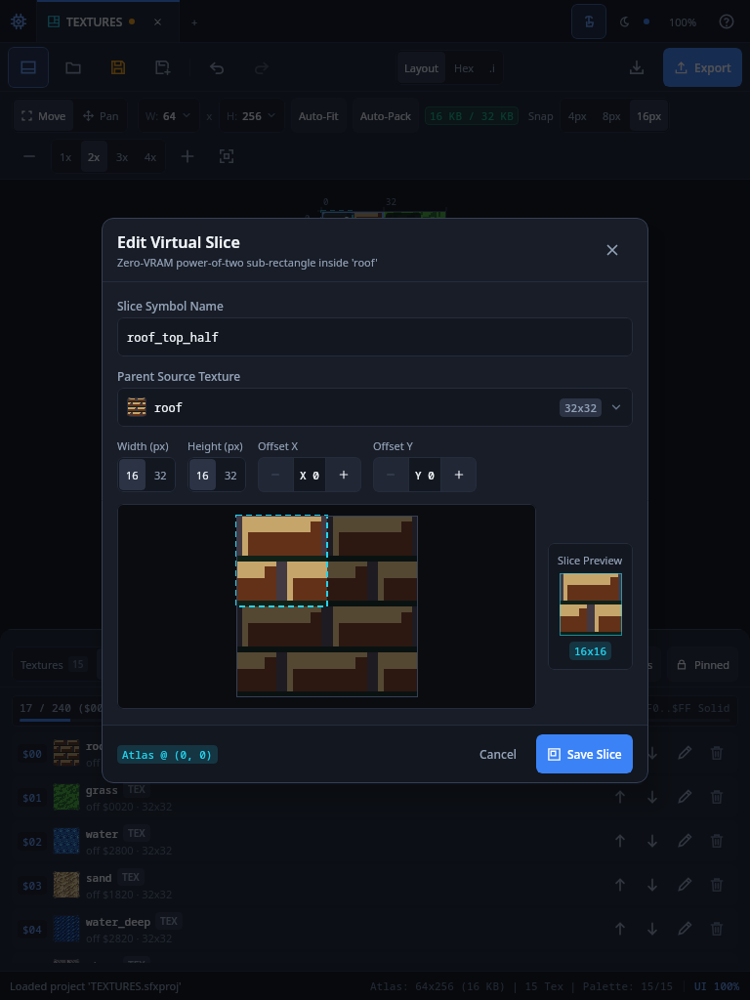
- **Hex & ca65 Index Previews — Desktop (`1600×960`)**:
  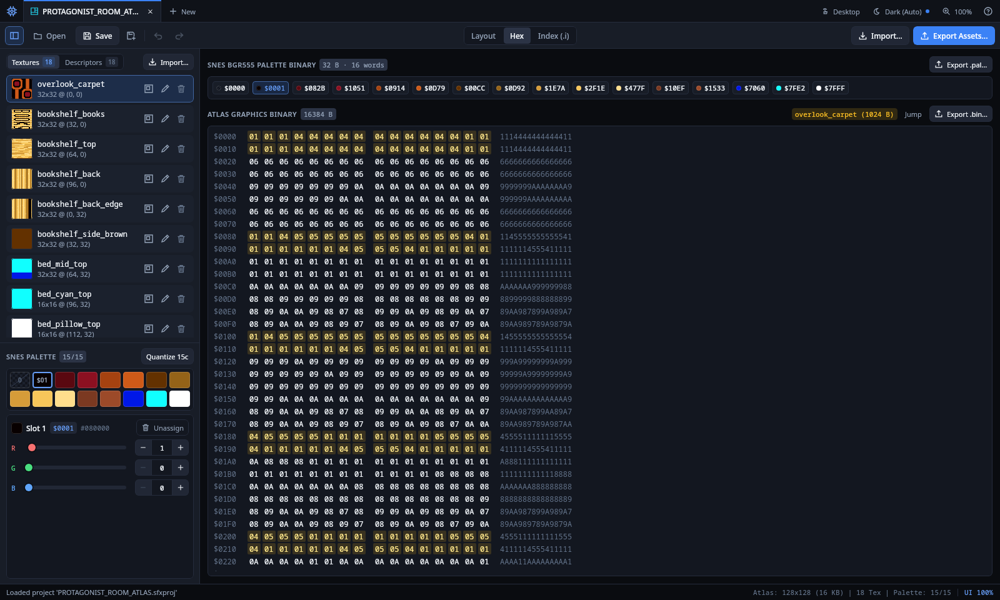
  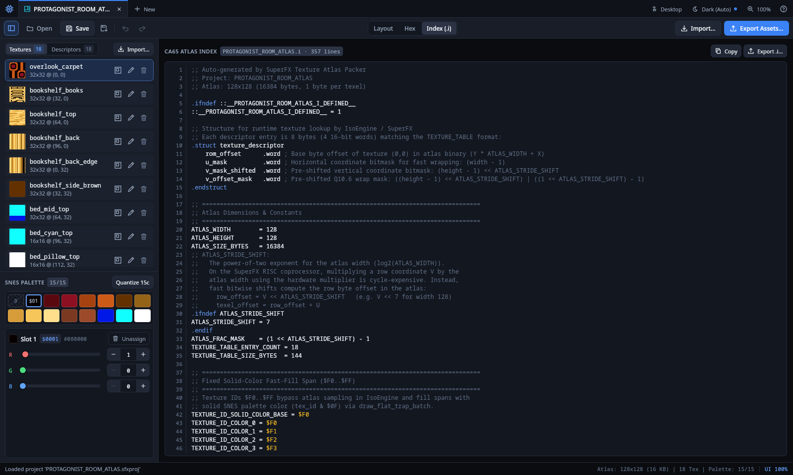
- **Export Assets Modal — Desktop & Tablet Portrait**:
  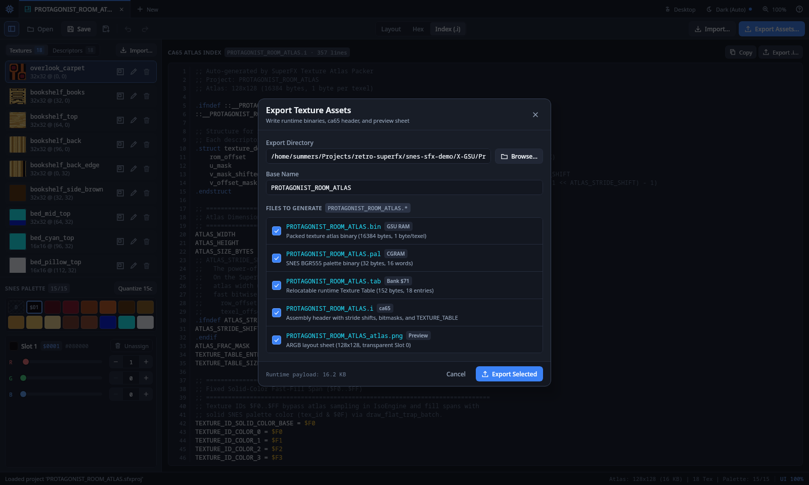
  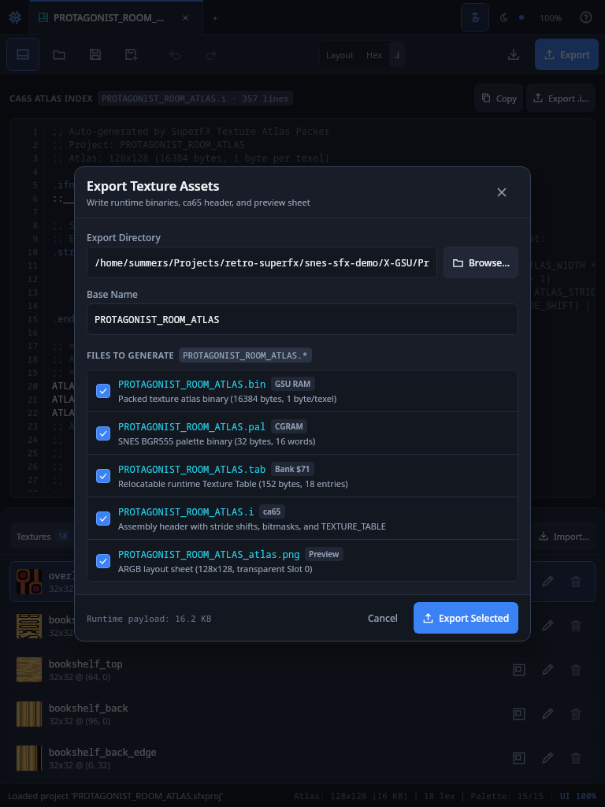

---

## Use Case 5: Creating a Linked Level & Cross-Tab Live Atlas Sync

**Goal**: Create an isometric **Level Document** linked with 1 tap to an open **Atlas Document** tab, and watch unsaved palette or pixel edits in the Atlas tab propagate live to the Level's 3D software preview without intermediate disk saves.

### Human Steps
1. Open **`+ New → New Level Document...`**, click an **Open-Tab Quick Link Chip** (`Link open tab: DEMO_ATLAS.sfxproj •`), pick dimensions (`4..16` or `8×8` / `12×12` / `16×16` presets) while checking the live `.map` byte payload readout, and click **Create Level**.
2. Edit any palette color or texture in the open Atlas tab (`DEMO_ATLAS •`), then switch back to the Level tab (`Live Tab` badge in the Shared Atlas card) to see updated colors immediately in both 3D and 2D viewports.

### Multi-Viewport Captures
- **Desktop (`1600×960`)**:
  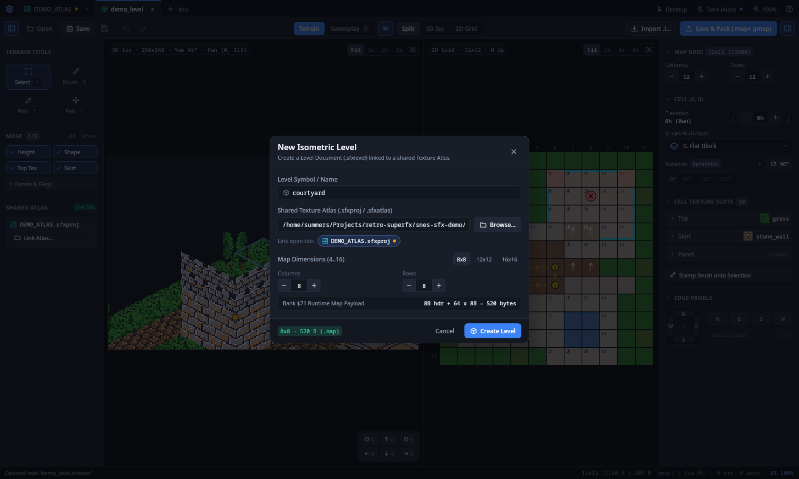
- **Tablet Portrait (`768×1024`)**:
  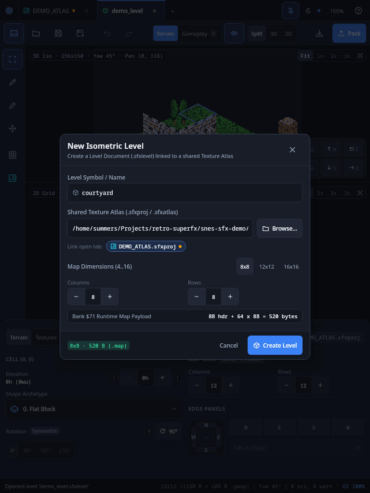

---

## Use Case 6: 3D/2D Isometric Terrain Sculpting, Brush Layer Masks & Camera Controls

**Goal**: Sculpt cell elevation (`baseHeight`), slopes/wedges/stairs (`ShapeArchetype` wireframe picker), rotations (`0°/90°/180°/270°`), surface textures (`Top`, `Skirt`, `Panel` + `$F0..$FF` solid colors), and perimeter **Edge Panels** (interactive spatial compass widget) across synchronized **3D Iso** and **2D Grid** viewports.

### Human Steps
1. Open `protagonist_room.sfxlevel` in **Terrain** mode (`Split`, `3D Iso`, or `2D Grid`).
2. Choose **Select** (`[V]`), **Brush** (`[B]`), **Pick** (`[I]`), or **Pan** (`[H]`), and toggle **Brush Layer Mask** chips (`Height`, `Shape`, `Top Tex`, `Skirt`, `Panels & Flags`) to paint specific channels without overwriting others.
3. Adjust elevation (`[` / `]` or stepper), wireframe `ShapeArchetype`, rotation, texture slots, and the interactive `N/E/S/W` **Edge Panels** compass in the inspector while orbiting/zooming (`Fit / 1× / 2× / 3×` + `Q/W/E/A/S/D` tactile pod).

### Multi-Viewport Captures
- **Desktop (`1600×960` — Dual Docks + Horizontal Split)**:
  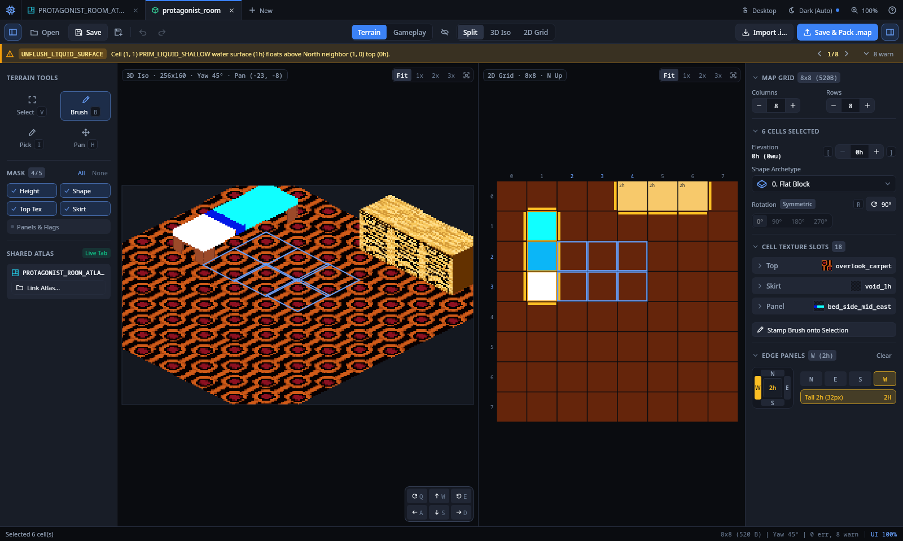
- **Tablet Landscape (`1024×768` — `52dp` Tool Rail + Mask Popover)**:
  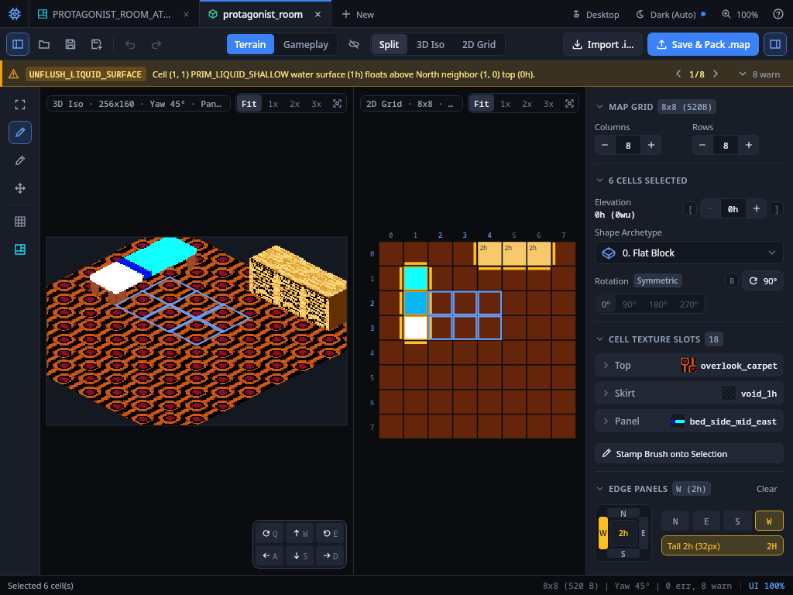
- **Tablet Portrait (`768×1024` — Vertical Stacked `3D`/`2D` Stage + 2-Column Bottom Sheet)**:
  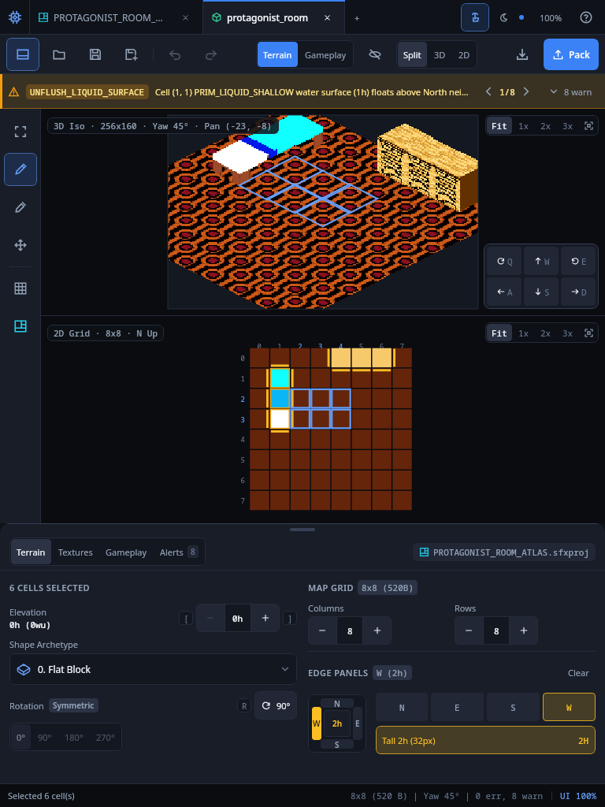

---

## Use Case 7: Tactical Gameplay Layer Authoring (`IsoRPGDemo` → `.gmap`)

**Goal**: Inspect and author S-CPU tactical RPG metadata (`GameplayLayer`) directly on the map: walkability & movement-cost overrides, **Player Spawn** + cardinal facing, **NPC Spawns** (`Guard` / `Patrol` AI, combat stats, `1..4` patrol waypoints), and **Interactables** (`Chest`, `Switch`, `Sign`), packed automatically to `.gmap` + `_gameplay.i`.

### Human Steps
1. Open `IsoRPGDemo/Data/demo_level.sfxlevel` — the **Gameplay Overlay** automatically highlights blocked tiles, `Player Spawn (2, 9)`, `patrol_slime (4, 6)` with its 4-waypoint dashed gold loop `(4,6) → (6,6) → (6,7) → (4,7)`, `guardian_knight (8, 2)`, and `hidden_chest (2, 3)` on both 3D and 2D viewports, plus a **Tactical Summary Card** in `Terrain` mode.
2. Switch the Command Bar pill from **Terrain** to **Gameplay** (`Gameplay 4`) to access the **Entity Roster**, paint walkability/cost overrides (`[Walk]`), place/edit **Player**, **NPCs**, click cells on the grid to append/toggle **Patrol** waypoints (`[M]`), or configure **Objects** (`Chest` / `Switch` / `Sign`), then click **Save & Pack (`.map+.gmap`)**.

### Multi-Viewport Captures
- **Terrain Mode with Live Gameplay Overlay & Tactical Card — Desktop, Tablet Landscape & Portrait**:
  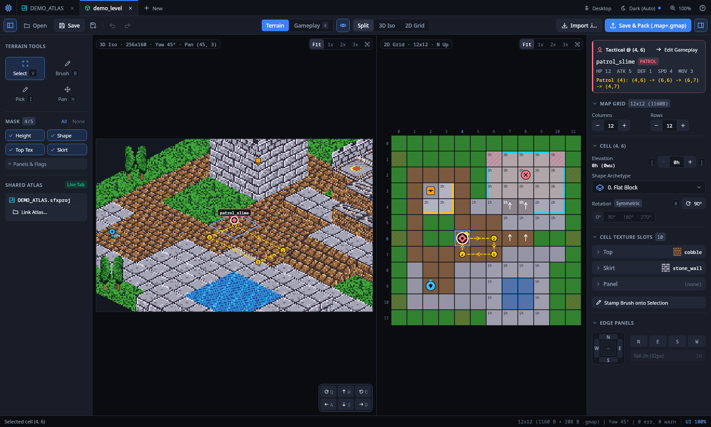
  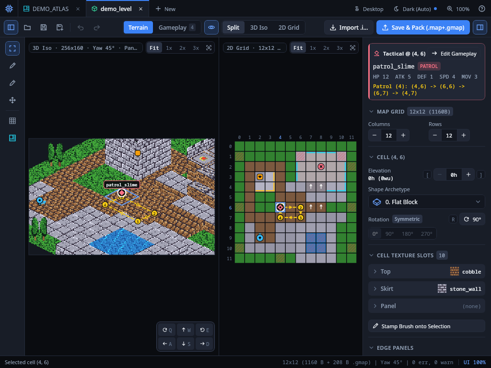
  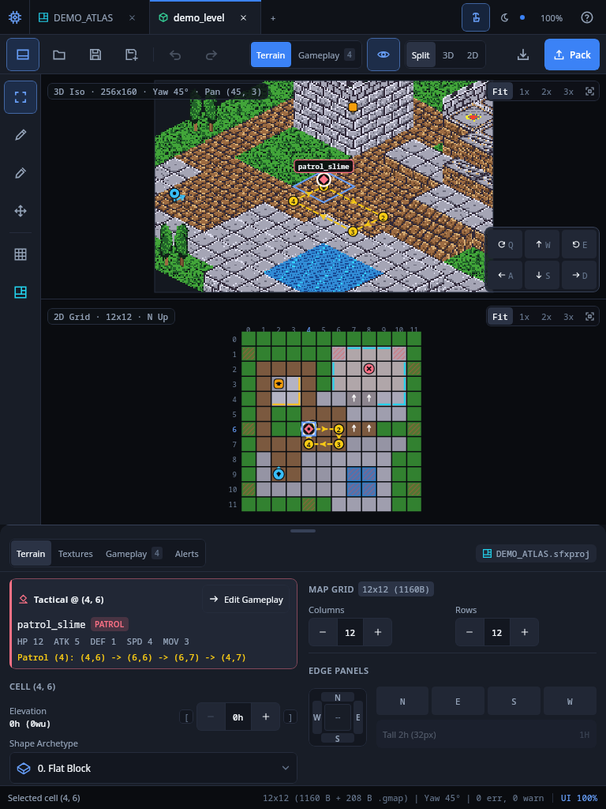
- **Dedicated `Gameplay` Authoring Mode (Roster, Stats & Patrol Waypoints) — Desktop & Tablet Portrait**:
  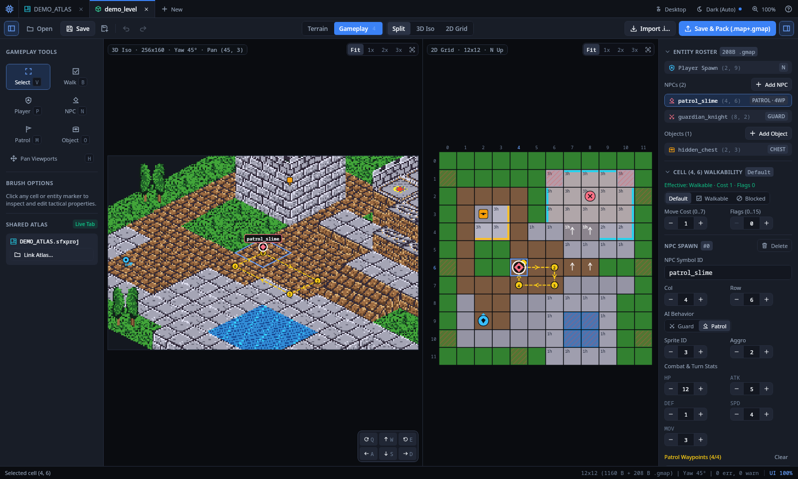
  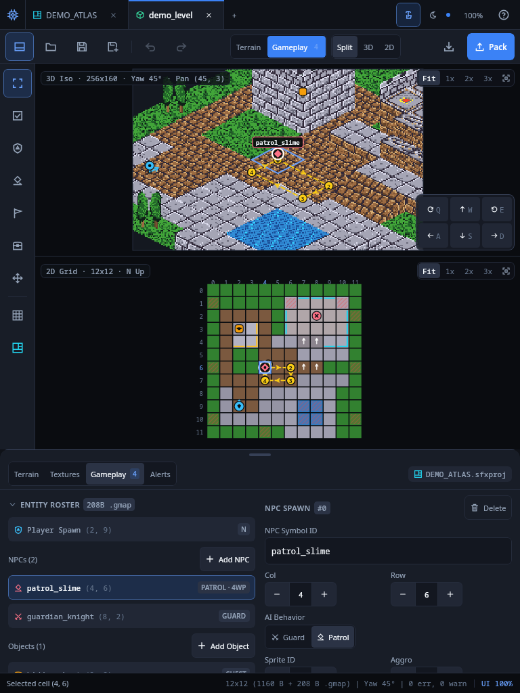

---

## Use Case 8: Live Validation Diagnostics & 1-Click Error Recovery

**Goal**: Catch hardware and format invariant violations in real time (unknown texture symbols, missing panel textures on active edge panels, unflush liquid surfaces, `> 240` descriptors, or `> 32 KB` Bank `$71` overflow) and jump straight to offending cells with 1-click quick fixes.

### Human Steps
1. Step through errors and warnings in the top **Diagnostics Banner** (`‹ 1/10 ›` or expand the full diagnostic list) to center selection and camera focus on the offending `(col, row)`.
2. Inspect the highlighted broken slot (`! MISSING_TEX_SYMBOL`) and **Cell Diagnostics** cards in the inspector, and click **Pick Top Texture**, **Pick Panel Texture**, or **Clear Panels** to resolve the issue immediately.

### Multi-Viewport Captures
- **Desktop (`1600×960`)**:
  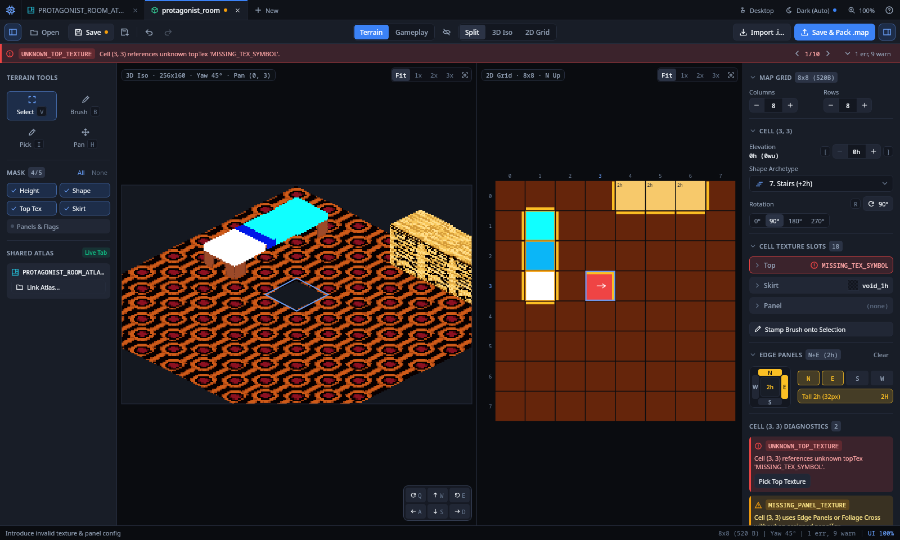
- **Tablet Portrait (`768×1024`)**:
  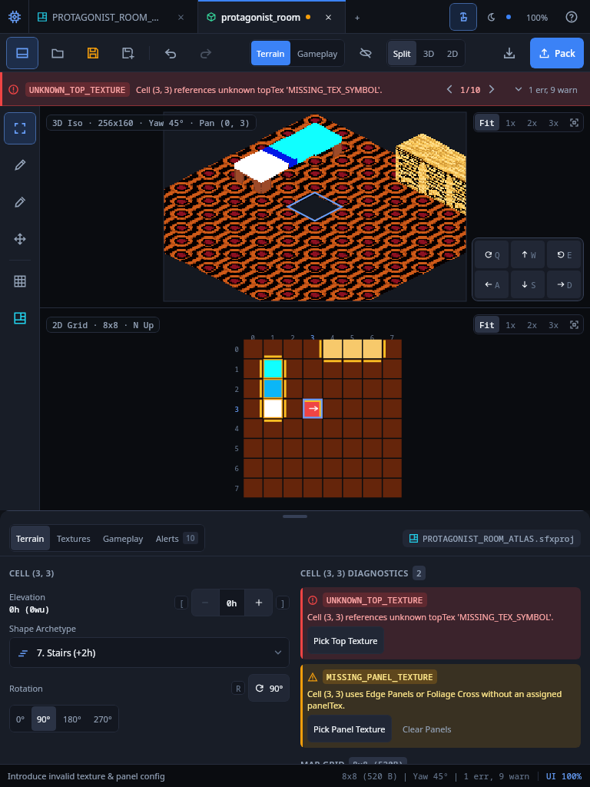

---

## Use Case 9: Cross-Platform Light/Dark Mode & System Accent Colors

**Goal**: Match the host desktop or tablet OS appearance (`System`, `Light`, or `Dark`) and accent palette across Linux (Freedesktop XDG Desktop Portal, GNOME/GTK `gsettings`, KDE Plasma `kdeglobals`), macOS (`AppleInterfaceStyle` / `AppleAccentColor` / `AppleHighlightColor`), and Windows (`AppsUseLightTheme` / DWM `AccentColor`), or override with one-click studio presets while maintaining WCAG-safe button ink and crisp pixel-art checkerboards.

### Human Steps
1. Launch SuperFX Studio — `PlatformAppearance` automatically detects the OS color scheme and system accent color on startup and refreshes live whenever the Studio window regains focus.
2. Click the **Appearance & Accent** pill in **Tier 1** of the Studio Header (sun/moon icon + live accent swatch dot, or use **`View → Appearance`** / **`View → Accent Color`** on Desktop) to switch between **`System`**, **`Dark`**, and **`Light`** modes.
3. Choose **`System Accent`** or any curated preset (**`Cobalt`**, **`Violet`**, **`Cyan`**, **`Emerald`**, **`Amber`**, **`Rose`**, **`Coral`**); `StudioColors.fromAppearance` clamps HSL lightness separately for Dark vs Light surfaces and computes contrast-safe `onAccent` foreground ink.

### Multi-Viewport Captures
- **Light Mode + System Violet Accent (`IsoRPGDemo` Gameplay Mode) — Desktop (`1600×960`) & Tablet Portrait (`768×1024`)**:
  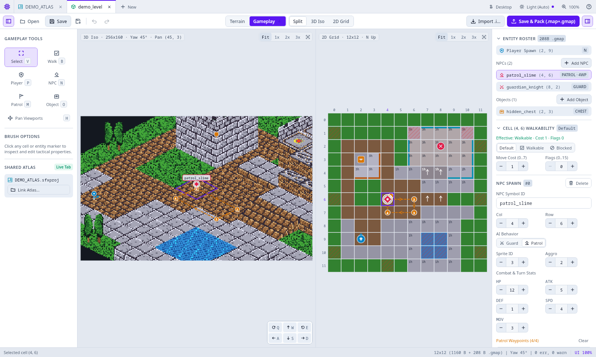
  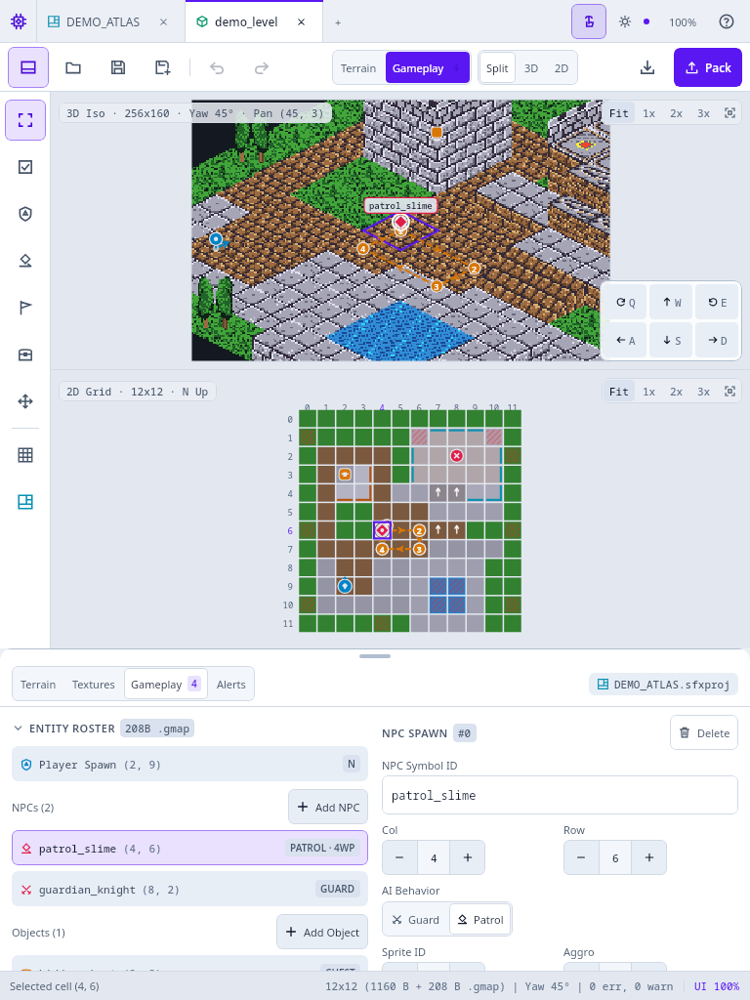
- **Light Mode + System Emerald Accent (`TEXTURES.sfxproj` Atlas Layout) — Desktop (`1600×960`) & Tablet Portrait (`768×1024`)**:
  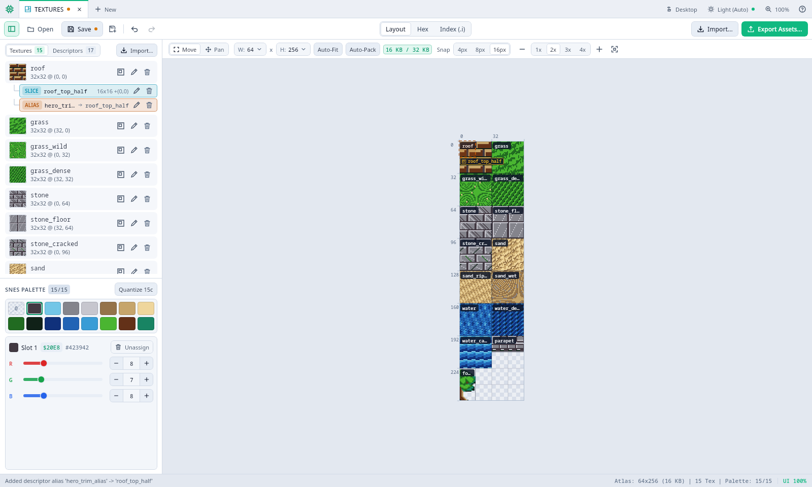
  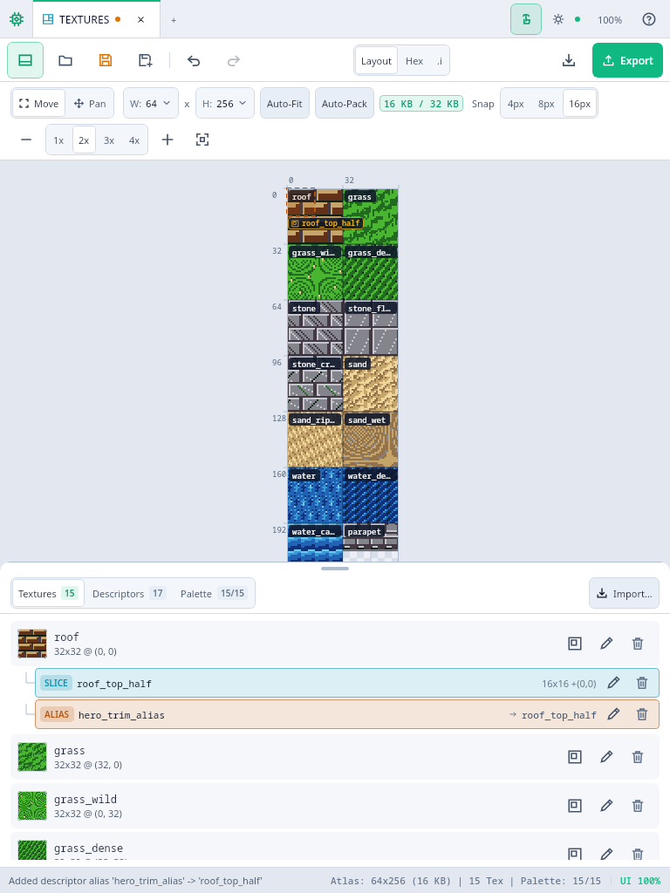
- **Dark Mode + Rose Accent Preset — Desktop (`1600×960`)**:
  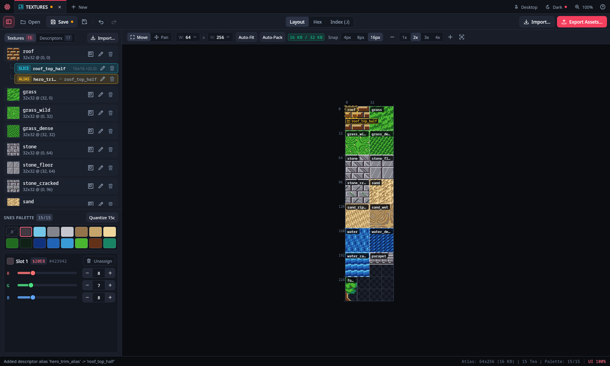
